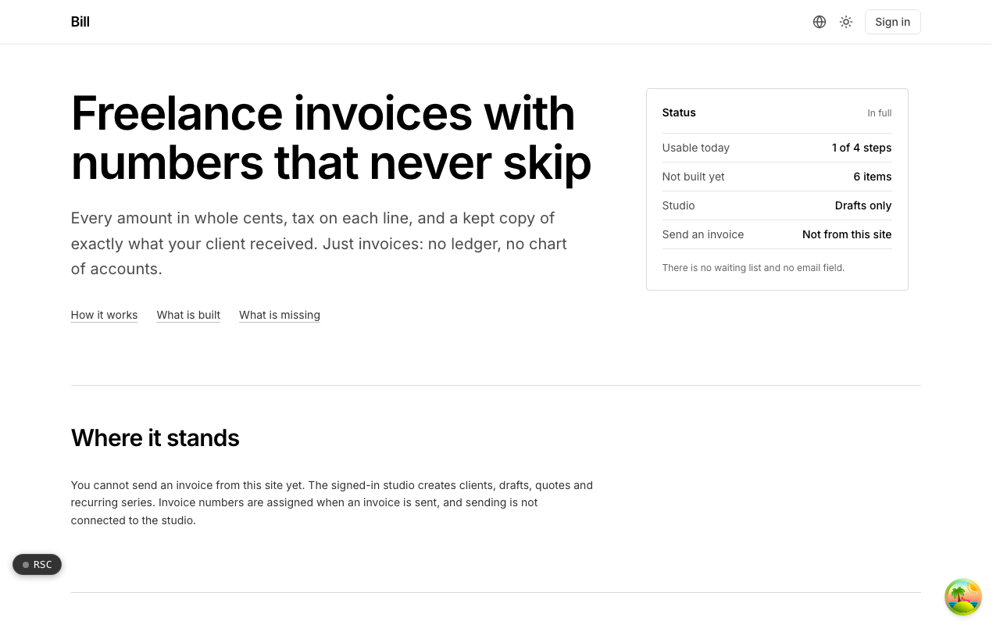

  <picture>
    <source media="(prefers-color-scheme: dark)" srcset=".github/assets/hero-dark.png">
    
  </picture>

# bill.me.at

Freelance invoices with numbers that never skip.

bill.me.at is freelance invoicing that stops at invoices: clients, drafts, sequential numbering, tax lines, payment links, quotes, and recurring series, with no ledger, chart of accounts, or accounting suite attached. It is for freelancers who need a clean, auditable invoice and nothing else.

> **Status:** in development. The signed-in studio creates clients, draft invoices, quotes, and recurring series, and a client can open a shared invoice link today. Sending an invoice from the studio is not built yet.

## Features

- **Gapless numbering**: drafts have no number; the number is assigned at send inside a row-locked transaction, so the sequence never has a gap and a voided invoice keeps its slot.
- **Amounts in whole cents**: every amount is an integer in minor units, with rounding at one known step so totals never drift.
- **Tax per line**: each line carries its own tax and rounding rule, and tax IDs are format-checked before they appear on a document.
- **Quotes that convert once**: an accepted quote becomes exactly one draft invoice; accepting after expiry records an expiry instead.
- **Recurring series**: a template plus a schedule kept by remind.me.at, opening one draft each time it fires.
- **The sent copy is kept**: one snapshot goes through one document pipeline, and the delivered file is stored so later edits never change what the client received.
- **Unguessable share links and a client portal**: invoices are shared under random tokens, and payment links may only point at allow-listed processors.
- **Self-hostable**: ships with a self-hosting kit; production use requires a license.

## Built with

- Next.js 16 (App Router), React 19, TypeScript
- Tailwind CSS 4
- oRPC + TanStack Query
- Drizzle ORM + Postgres
- Better Auth (shared `*.me.at` account)

## Part of the me.at family

bill.me.at is one of the [`*.me.at`](https://me.at) apps by Trevor McDougald. They share one design system, account, and app shell. Development happens in a private monorepo; this repository is the project's public-facing home.

## License

See [LICENSE](LICENSE).
