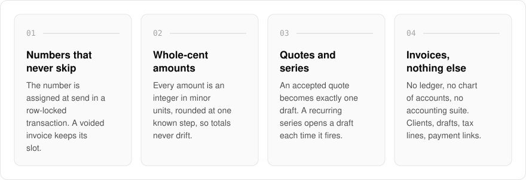
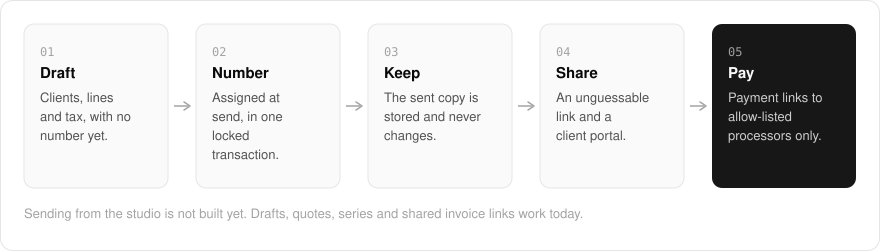

  <picture>
    <source media="(prefers-color-scheme: dark)" srcset=".github/assets/hero-dark.png">
    
  </picture>

<h1 align="center">bill.me.at</h1>

<strong>Freelance invoices with numbers that never skip.</strong>

  
  
  
  

  <a href="#features">Features</a> ·
  <a href="#how-it-works">How it works</a> ·
  <a href="#built-with">Built with</a>

Most invoicing tools arrive with a ledger, a chart of accounts and an accounting suite you never asked for. I built bill.me.at to stop at invoices: clients, drafts, sequential numbering, tax lines, payment links, quotes and recurring series. Numbers never skip, amounts never drift, and the copy a client received never changes after it is sent. It is for freelancers who need a clean, auditable invoice and nothing else.

> **Status:** in development. The signed-in studio creates clients, draft invoices, quotes, and recurring series, and a client can open a shared invoice link today. Sending an invoice from the studio is not built yet, and PDF output is not served until its renderer passes verification.

  <picture>
    <source media="(prefers-color-scheme: dark)" srcset=".github/assets/overview-dark.svg">
    
  </picture>

## Why bill.me.at

| The usual invoicing tool | bill.me.at |
| --- | --- |
| An accounting suite attached | Invoices, quotes and recurring series, nothing else |
| Numbers that can skip or repeat | A gapless number assigned at send, in one locked transaction |
| Floating-point totals | Whole cents, rounded at one known step |
| Edits can change what the client saw | The sent copy is stored and never changes |
| Payment links to anywhere | Payment links to allow-listed processors only |

## Features

- **Gapless numbering**: drafts have no number. The number is assigned at send inside a row-locked transaction, so the sequence never has a gap and a voided invoice keeps its slot.
- **Amounts in whole cents**: every amount is an integer in minor units, with rounding at one known step so totals never drift.
- **Tax per line**: each line carries its own tax and rounding rule, and tax IDs are format-checked before they appear on a document.
- **Quotes that convert once**: an accepted quote becomes exactly one draft invoice. Accepting after expiry records an expiry instead.
- **Recurring series**: a template plus a schedule kept by remind.me.at, opening one draft each time it fires.
- **The sent copy is kept**: one snapshot goes through one document pipeline, and the delivered file is stored so later edits never change what the client received.
- **Unguessable share links and a client portal**: invoices are shared under random tokens, and payment links may only point at allow-listed processors.
- **Self-hostable**: ships with a self-hosting kit. Production use requires a license.

## How it works

  <picture>
    <source media="(prefers-color-scheme: dark)" srcset=".github/assets/flow-dark.svg">
    
  </picture>

A draft holds the client, the lines and their tax, and has no number yet. At send, the next number is assigned inside one row-locked transaction and a snapshot of the invoice is stored, so the copy the client sees is fixed. The client opens it under an unguessable link or in the portal, and pays through a link that can only point at an allow-listed processor.

## Built with

  
  
  
  
  

- Next.js 16 (App Router), React 19, TypeScript
- Tailwind CSS 4
- oRPC + TanStack Query
- Drizzle ORM + Postgres
- Better Auth (shared `*.me.at` account)

## Part of the me.at family

bill.me.at is one of my [`*.me.at`](https://me.at) apps. They share one design system, account, and app shell. Development happens in a private monorepo; this repository is the project's public-facing home.

## License

Source-available. See [LICENSE](LICENSE).
